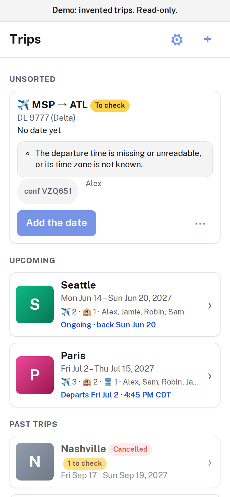
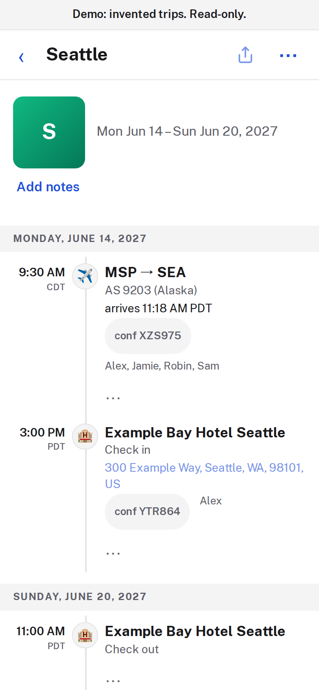
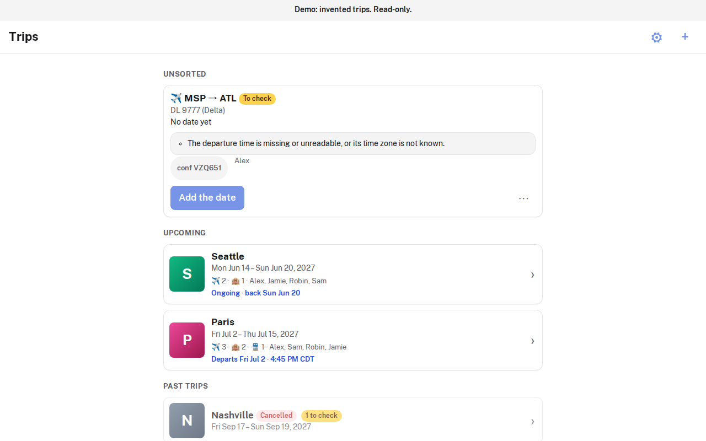
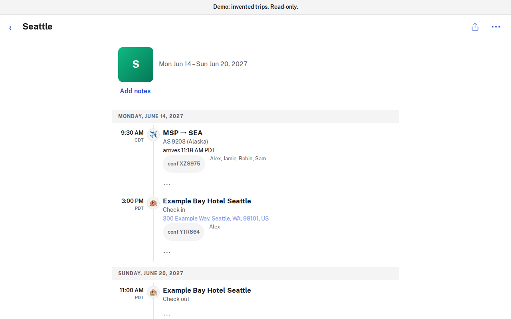

# tripbox

Forward your travel confirmation emails to tripbox and it turns them into trips on a page laid
out for a phone (tested at phone widths, not yet on a real phone): upcoming and past trips, a
timeline for each day, a link to share a trip, a calendar feed. It runs on a computer of your
own, standalone. If you keep a flight log in
[AirTrail](https://github.com/johanohly/AirTrail), tripbox can also add your flights to it.

| The trips | One trip |
|---|---|
|  |  |

The first card of the list is the demo's example of a booking marked **To check**: a flight
whose email gave no date, waiting in Unsorted until you add one.

A live demo with invented trips, and nothing of anyone's, is at
https://good-work-dojo.github.io/tripbox/. Its pages are saved copies: nothing on them can be
changed.

## What it does

- Reads a confirmation email (from a mailbox, a pasted text, an `.eml` file or a PDF) and files
  each flight, stay, car and train in it as a booking, grouped into trips by their dates.
- Reads emails that carry structured data (booking details written for programs to read, which
  some senders put in) with no model at all. A model, if you give it one, reads the rest; without
  one, those emails wait until you do. Many emails carry no structured data, and one forwarded by
  hand loses it: see "Choose a model".
- Never invents a field: what an email does not print stays empty, and a booking it is unsure of
  is marked **To check** on the page until you have looked.
- Keeps everything in one SQLite file and the emails as they arrived, on your own disk.

It is not a planner: it does not search for flights, suggest places or book anything. It files
what you were already sent.





## Requirements

- Docker with the Compose v2 plugin: `docker compose version` prints a version. The old
  `docker-compose` (1.x) is not enough.
- An amd64 or an arm64 computer. The arm64 image reads emails with an older version of the
  extractor than the amd64 one, so a few emails that carry structured data there may need a model.
- About 2 GB of free memory: the services are capped at 512 MB for the page, 1 GB for the worker
  and 512 MB for the Telegram bot, which only runs when you ask for it.
- A mailbox only if you want mail read by itself; you can paste or upload a booking without one.

## Quick start

In an empty directory:

<!-- block: quickstart -->
```sh
curl -fsSL https://github.com/Good-Work-Dojo/tripbox/releases/latest/download/tripbox.tar.gz | tar -xz && cd tripbox
(umask 077 && echo 'TRIPBOX_PASSWORD=<choose a password of 10 characters or more>' > .env)
docker compose up -d
```

In this README, text in angle brackets such as `<choose a password …>` is a placeholder: replace
it, brackets included. A password of fewer than 10 characters (or the placeholder left as it is)
is refused: the page does not start, and `tripbox doctor` says why.

Run the three in one terminal, in order. The first leaves you inside the new `tripbox` folder, and
the second writes `.env` there, beside `compose.yaml`; `docker compose` reads it from there. The
services run as user 1000: if yours is another (`id -u`), see
[what the bundle holds](docs/install.md#what-the-bundle-holds) before the third.

Then open http://localhost:8110. The first page is a sign-in page that asks for the password you
put in `.env`. In `.env` a `$` is written `$$`, so a password that holds a `$` goes in with each
one doubled, and so does any other value in `.env`, a mail password included; you type the page's
password as it is at the sign-in. A value is also cut at a space followed by `#`, and one that
starts with a quote is read as quoted, however the file was written, so choose a password with
neither. The quick start's `echo '…'` cannot hold a `'` either: if one must, make `.env` in an
editor.

If port 8110 is already taken on this computer, append two lines to `.env` before the third
command, with a free port in place of 8111, then open http://localhost:8111 instead:

```sh
echo 'TRIPBOX_LISTEN=127.0.0.1:8111' >> .env
echo 'TRIPBOX_BASE_URL=http://localhost:8111' >> .env
```

Always append to `.env` with `>>` (or edit the file in an editor): a single `>` replaces the whole
file, the password line with it. `.env.example`, beside it, lists every setting with a short note
to copy from; tripbox never reads it. After you edit `.env` while the stack runs, run
`docker compose up -d` again: it recreates the services whose settings changed. (`docker compose
up -d --force-recreate` recreates them all.) A file you add or change in `config/` is read when a
service starts, and `up -d` does not see a change there: run `docker compose restart` after it.
To stop it, `docker compose down` (see "Leaving").

Two settings are worth a line in `.env` at once. `TZ` (an IANA name such as `America/Chicago`)
decides what "today" is, and with it which trips are upcoming; it is UTC until you set it.
`TRIPBOX_HOME_AIRPORTS` (such as `MSP`) names the airports you live near, so that a trip is
titled by the place you went. See [configuration](docs/configuration.md#core).

### On a server

To reach the page from other computers, append these two lines to `.env` (with `>>`, as above)
before `docker compose up -d`, with your server's name or address in place of the placeholder:

<!-- block: server -->
```ini
TRIPBOX_LISTEN=0.0.0.0:8110
TRIPBOX_BASE_URL=http://<its name or address>:8110
```

Plain http on every interface suits a home network only. A server on the internet needs a proxy
that serves https: see [the proxy recipes](docs/reverse-proxy.md) and
[the security notes](docs/security.md).

## Try it

Open **Add a booking** on the page, choose **Paste its text**, paste the text of the block below,
from `From:` to `</html>`, as one text (the header lines, the empty line and the body together;
the lines of three backticks that frame the block are not part of it), and send it:

<!-- block: sample -->
```
From: Sample Air <no-reply@sample-air.example>
To: alex@example.com
Subject: Your flight is booked: ZQ4K7M
Date: Tue, 15 Jun 2027 09:00:00 -0500
Message-ID: <sample.zq4k7m@mta.example>
MIME-Version: 1.0
Content-Type: text/html; charset="utf-8"

<html><body>
<p>Your flight is booked.</p>
<script type="application/ld+json">
{
  "@context": "https://schema.org",
  "@type": "FlightReservation",
  "reservationNumber": "ZQ4K7M",
  "reservationStatus": "https://schema.org/ReservationConfirmed",
  "underName": {"@type": "Person", "name": "Alex Sample"},
  "reservationFor": {
    "@type": "Flight",
    "flightNumber": "AS9215",
    "airline": {"@type": "Airline", "name": "Alaska Airlines", "iataCode": "AS"},
    "departureAirport": {"@type": "Airport", "iataCode": "MSP"},
    "departureTime": "2027-07-08T09:30:00-05:00",
    "arrivalAirport": {"@type": "Airport", "iataCode": "SEA"},
    "arrivalTime": "2027-07-08T11:18:00-07:00"
  }
}
</script>
</body></html>
```

The page says `Received.` at first, then, within a few seconds, `Filed`, and links the trip it
made: one flight, no model asked. Nothing was sent anywhere. Delete the trip from its page when
you are done.

## Check your setup

At any time, with the stack running or stopped, this says what is set up, what is off and what is
wrong, and prints no secret. It reads your settings and checks the folders; it never tries a login
or a server:

<!-- block: doctor -->
```sh
docker compose run --rm worker tripbox doctor
```

A feature you have not set up (`mail`, `model`, `airtrail`, `notifications`, `enrichment`) is a row
that says `off` and what turns it on; that is no fault. The `worker` row (the worker is the service
that reads mail and keeps the flight log in step) says `stopped` while the stack is down, and `none`
before the worker first ran.

Every other `tripbox …` command these pages name runs the same way, in the worker:
`docker compose run --rm worker tripbox <command>`. One that is given a file (`tripbox ingest`,
`tripbox report`) reads it from standard input, because the container sees only the install's
folders: `docker compose run --rm -T worker tripbox ingest - < booking.eml`.

## Connect a mailbox

Mail is optional. tripbox reads one mailbox over IMAP: give it a mailbox of its own, such as
`trips@example.com`, and forward confirmations to it. Only mail from or through the senders you
list is read, and only mail arriving from then on: older mail is read when you ask (`tripbox mail
backfill`, see [mail](docs/mail.md)). The page's status card and `tripbox doctor` say why nothing
arrives. `doctor` names a setting that is missing or wrong. It does not try the login, so a
wrong password still shows `mail on`; the status card does: `The mailbox could not be checked
(…)`, once the worker has tried. `tripbox poll` tries the login at once and
files what it fetches, as the worker does, so stop the worker first and start it again after:
`docker compose stop worker`, then `docker compose run --rm worker tripbox poll`, then
`docker compose up -d`. The same holds for `tripbox mail backfill --apply`, `tripbox replay` and
`tripbox ingest`: two readers of one message can double its log rows or ask the model twice.
(`tripbox check` asks the model, AirTrail and the notifiers, not the
mailbox.)

For a Gmail mailbox, make an app password in the mailbox's own Google account; Google offers
app passwords only once 2-Step Verification is on there. Google shows it in four groups with
spaces: write it without the spaces (tripbox removes spaces in any case). [The Gmail
recipe](docs/gmail-filters.md) makes the filters that forward your mail to the mailbox. Append
these lines to `.env` (replace each placeholder, brackets included, and each `example.com`
address with your own), then, without stopping
anything, run `docker compose up -d` again:

<!-- block: mailbox-gmail -->
```ini
TRIPBOX_MAIL_HOST=imap.gmail.com
TRIPBOX_MAIL_USER=trips@example.com
TRIPBOX_MAIL_PASSWORD=<an app password>
TRIPBOX_MAIL_ALLOWED_SENDERS=alex@example.com
```

For any other mailbox that offers IMAP over TLS on port 993 and signs in with a password (no
OAuth, so not Outlook or Microsoft 365), no sender is vouched for, so each flight that arrives by
mail waits for you to look at it before it goes to a flight log, if you keep one (see
[mail](docs/mail.md)):

<!-- block: mailbox-other -->
```ini
TRIPBOX_MAIL_HOST=imap.example.com
TRIPBOX_MAIL_USER=trips@example.com
TRIPBOX_MAIL_PASSWORD=<the mailbox's password>
TRIPBOX_MAIL_ALLOWED_SENDERS=alex@example.com
TRIPBOX_MAIL_TRUST=mailbox
```

The Gmail path has been tested with recorded headers only,
and a mailbox that is not Gmail's has never been tried against a real server.

## Choose a model

Emails that carry structured data (some airlines and booking sites put it in their emails; many
senders do not) are read with no model. That data survives a Gmail filter's forward, an attached
original and an uploaded `.eml` of the original, and is lost when you forward an email by hand or
paste its text from a screen. So with no model, let a filter forward your mail, or attach the
original, or upload its `.eml`; an email forwarded by hand will wait. On the project's own corpus of
invented emails the extractor reads only a few and a model nearly all the rest; one is read by
nothing (the counts are in the scorecard in
[models](docs/models.md#reading-how-a-model-does-tripbox-eval)).
For the rest, tripbox can ask a model: `anthropic` (the default; give it a key), `openai` (OpenAI's
service or any server that speaks its API, such as one you run) or `none`. What is sent is the
email's text, and with `anthropic` its PDFs, and nothing from your settings or your trips. A monthly
cap stops the spending. Mail that cannot be read now waits and is read once a model is there. To set
one up, append these lines to `.env` and run `docker compose up -d` again; the key is a secret, and
`tripbox check` asks the model whether it answers:

```ini
TRIPBOX_LLM_PROVIDER=anthropic
TRIPBOX_LLM_API_KEY=<an Anthropic key>
```

tripbox has not been run against a real model on the corpus, and the `openai` provider has not
been tried against a real server. See [models](docs/models.md) and
[what is shared](docs/privacy.md).

## Add AirTrail

With an AirTrail API key and your name in `config/travellers.yaml`, tripbox adds the flights you
are on to your AirTrail and never deletes anything there. It starts in a dry run that sends
nothing. Run `docker compose restart` after you add or change the travellers file: the services
read it once, when they start. See [the flight log](docs/airtrail.md).

## How safe it is

- The page asks for a password by default (or a login proxy or Cloudflare Access); with no login
  it answers this computer alone.
- The page runs in a container that holds no mailbox, model, AirTrail or notification secret.
- Mail is read only from the senders you list. With a flight log, a flight of yours from a sender
  nobody vouched for waits for your look before it reaches the flight log.
- Nothing is ever deleted in AirTrail, and what is not printed in an email is never invented.
- The page loads nothing from another site and tells search engines to keep away.
- A share link shows only what you ticked, to anyone who has the link.

The full list, with what has and has not been tried, is in [the security notes](docs/security.md).

## Behind a proxy

Recipes for Caddy, nginx and Traefik, at a hostname of their own or a sub-path, and one for AirTrail
and tripbox at one hostname, are in [docs/reverse-proxy.md](docs/reverse-proxy.md).

## Back up and upgrade

The ledger (the one SQLite file that holds your trips) and the files in `config/` are in one
archive, not `.env` (keep that yourself), written into `backups/` (a new file, mode 600) while
tripbox keeps running:

<!-- block: backup -->
```sh
docker compose run --rm worker tripbox backup
```

Copy it somewhere else. Emails are left out unless you add `--with-mail` (they are personal data).
To upgrade, back up first, then pull the new image and start it:

<!-- block: upgrade -->
```sh
docker compose run --rm worker tripbox backup
docker compose pull
docker compose up -d
```

[Installing and upgrading](docs/install.md) has restoring, rootless Docker and the rest.

## Leaving

Your data is one SQLite file, `data/ledger.db`, and the emails as plain `.eml` files under
`archive/`. Nothing is locked in: stop the stack and take both.

`docker compose stop` stops the services and `docker compose up -d` starts them again.
`docker compose down` removes the containers and their network; your data stays, because it lives
in the folders beside `compose.yaml` (`data`, `archive`, `logs`, `config`, `backups`), which the
stack mounts from your disk. It creates no Docker volume, so `down -v` removes nothing more. To
remove tripbox entirely, run `docker compose down`, then delete the `tripbox` folder.

## Report a parse problem

If an email is read wrongly, make a redacted report of it and put the report, not the email, in an
issue:

<!-- block: report -->
```sh
docker compose run --rm -T worker tripbox report 12 --name "<your name>" > tripbox-report.txt
```

`12` is the message's number (`tripbox report` alone lists the newest). Give `--name` once for
each traveller on the booking: with no travellers file, a name nothing else gave tripbox stays in
the report. Read the report before you share it, and never attach an original email.
[What the report keeps and removes](docs/privacy.md) is in the privacy notes.

## How well it reads

`tripbox eval` files a corpus of invented emails and says which it read right, with a model of
yours; it spends on your key, outside the monthly cap. See [models](docs/models.md).

## More

[Configuration](docs/configuration.md) has every setting and the optional files in `config/`;
[architecture](docs/architecture.md) is a short tour of how the parts fit; the
[roadmap](docs/ROADMAP.md) lists what tripbox does not do yet.

## Licence

tripbox is free software under the GNU Affero General Public License v3.0 only, with the added
terms in [NOTICE](NOTICE); the name and logo are covered by [TRADEMARKS.md](TRADEMARKS.md).
Contributions are welcome: see [CONTRIBUTING.md](CONTRIBUTING.md). Security reports go by
[SECURITY.md](SECURITY.md).
